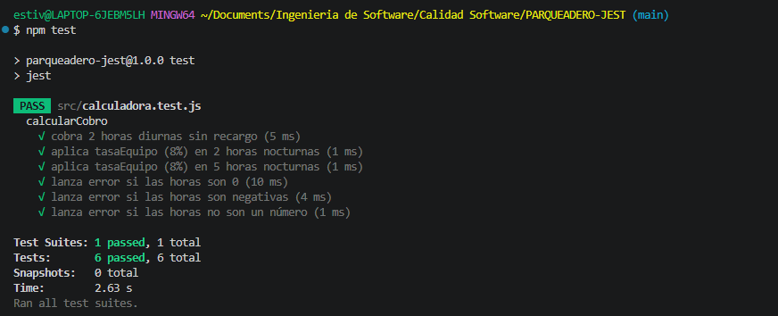

# Parqueadero - Pruebas unitarias con Jest

Taller final de Calidad del desarrollo de software - CIAF

## Integrante
| N° de lista | Cristian Estiven Gomez Cardenas |
|---|---|
| [8 o 20] | [Cristian Estiven Gomez Cardenas] |

- **N:** [8 o 20]
- **tasaEquipo:** (N mod 5) + 5 = [8% o 5%]

## Negocio elegido
Parqueadero que cobra $3.000 por hora. Si el servicio es nocturno,
se aplica un recargo igual a la tasaEquipo ([8% o 5%]) sobre el valor base.

## Casos de prueba
| # | Tipo | Entrada | Salida esperada |
|---|---|---|---|
| 1 | Normal | 2 horas, diurno | 6000 |
| 2 | Normal | 2 horas, nocturno | [6480 o 6300] |
| 3 | Normal | 5 horas, nocturno | [16200 o 15750] |
| 4 | Borde | 0 horas | Error "Entradas inválidas" |
| 5 | Borde | -3 horas | Error "Entradas inválidas" |
| 6 | Borde | "dos" (texto) | Error "Entradas inválidas" |

## Cómo ejecutar
    npm install
    npm test

## Resultado de las pruebas
